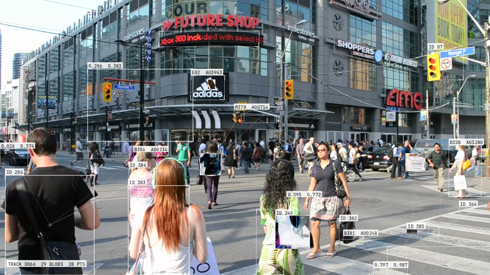

# blob-tracker

The "blob tracking" video effect from TouchDesigner-style edits: white boxes
that lock onto bright, dark, edge-dense and moving regions and follow them,
lines joining them, white numeric chips, a few inverted windows and
optical-flow corner markers, all screen-blended into the picture. It ships as
a Python CLI and module, a browser module on OpenCV.js that produces the same
detections, a static web app, and a Claude Code skill. It is a visual effect:
the boxes follow image regions, not recognised objects.



| path | use it for | code |
|---|---|---|
| [CLI](#cli) | a video file in, a video file out | `skills/blob-tracking/scripts/blobtrack.py` |
| [Python module](#python-module) | your own frame loop | same file |
| [Browser module](#browser-module) | a web project | `skills/blob-tracking/scripts/blobtrack.js` |
| [Web app](#web-app) | upload, preview, download in the browser | `app/` |
| [Claude Code skill](#claude-code-skill) | let Claude pick the path and run it | `skills/blob-tracking/` |

How the look was found: [case study](casestudy/index.html) (a static page;
open the file directly in a browser).

## CLI

Needs Python 3.9+ and `ffmpeg` + `ffprobe` on `PATH` (4.1 or newer
recommended).

```sh
python3 -m venv .venv
.venv/bin/python -m pip install -r skills/blob-tracking/scripts/requirements.txt
.venv/bin/python skills/blob-tracking/scripts/blobtrack.py in.mp4 -o out.mp4
```

On Windows, create the venv with `py -m venv .venv` and use
`.venv\Scripts\python.exe`.

The output is H.264 MP4 at the input's size, frame rate and frame count, with
the audio copied. Key flags:

- `--start SEC --duration SEC`: process a section
- `--overwrite`: replace an existing output (refused by default)
- `--crf N`: x264 quality, default 16, lower is better
- `--no-audio`: drop the sound
- `--large 6 --medium 11 --small 15`: max boxes per size tier (density)
- `--bright 90 --dark 9 --motion 14`: detection thresholds
- `--labels`, `--invert`, `--shift`, `--screen`, `--chip`, `--corners`: look

`--help` lists every flag with its default. The
[skill](skills/blob-tracking/SKILL.md#parameters) documents each parameter
and how to tune it.

## Python module

Same file, same dependencies. Frames are `H x W x 3` RGB `uint8` arrays, fed
in order, one tracker per clip; `process()` returns the treated frame.

```python
import sys
sys.path.insert(0, "skills/blob-tracking/scripts")
from contextlib import closing
from blobtrack import BlobTracker, probe, read_frames, run

info = probe("in.mp4")
bt = BlobTracker(info["width"], info["height"], small=25)
with closing(read_frames("in.mp4", info)) as frames:
    for rgb in frames:
        out = bt.process(rgb)       # treated frame, same shape
        print(bt.last_tracks[:2])   # [{id, x, y, w, h, kind, a, age}, ...]
        break

run("in.mp4", "out.mp4", params={"small": 25})   # whole file with audio, like the CLI
```

`run()` refuses an existing output unless you pass `overwrite=True`. Bad
parameters raise `BlobTrackError` (a `ValueError`).

## Browser module

`blobtrack.js` is a plain ES module with no build step. Copy it together with
`JetBrainsMono-Regular.ttf` (the chip font, loaded from beside the module)
into your project. Serve the page over HTTP, not `file://`; `loadOpenCV()`
fetches OpenCV.js (about 10 MB) from cdn.jsdelivr.net.

```js
import { loadOpenCV, BlobTracker } from "./blobtrack.js";

await loadOpenCV();                                    // once per page
const bt = new BlobTracker(W, H, { small: 15 });       // one per clip
const src = new OffscreenCanvas(W, H).getContext("2d", { willReadFrequently: true });
const outCtx = document.querySelector("canvas").getContext("2d");

// per frame, in order:
src.drawImage(frame, 0, 0, W, H);                      // a VideoFrame, <video>, ImageBitmap...
bt.process(src.getImageData(0, 0, W, H), outCtx);      // draws the treated frame into outCtx

bt.dispose();                                          // frees OpenCV memory
```

For whole-file MP4 output, see [`app/app.js`](app/app.js) or the condensed
Mediabunny example in the [skill](skills/blob-tracking/SKILL.md#c-browser--js-project).

## Web app

```sh
./app/serve.sh        # or: npm run serve    (port: ./app/serve.sh 9000)
```

Open <http://localhost:8000/app/>, pick a video, process it, preview the
result and download the MP4. Everything runs in the browser; nothing is
uploaded. It needs WebCodecs and has been tested in Chrome only.

## Claude Code skill

Install it from this repo's plugin marketplace, inside Claude Code:

```
/plugin marketplace add k1sh0r/blob-tracker
/plugin install blob-tracking@blob-tracker
```

Or copy `skills/blob-tracking/` into `~/.claude/skills/` (all projects) or a
project's `.claude/skills/`. Then ask for the effect in plain words ("add
blob tracking to clip.mp4"); the skill picks the CLI, Python, browser or
porting path that fits the project. See
[SKILL.md](skills/blob-tracking/SKILL.md) and its
[references](skills/blob-tracking/references/).

## Tests

```sh
python3 -m venv .venv
.venv/bin/python -m pip install -r tests/requirements-dev.txt
.venv/bin/python -m pytest tests

npm install
npm run test:parity   # Python vs browser detections, in headless Chrome
npm run test:app      # web app end to end: upload, process, check the MP4
```

`tests/requirements-dev.txt` pins the OpenCV version the reference
detections in `tests/fixtures/` were made with. Both npm tests drive the
installed Google Chrome; `test:app` also needs `ffmpeg`, and `test:parity`
adds a Python side-by-side image when `.venv` exists.

## Notes

- Output is SDR, tagged BT.709. HDR and 10-bit input is untested.
- Output is deterministic: the same input and parameters give the same
  frames.

## Credits

- [OpenCV](https://opencv.org/) (Apache 2.0), via `opencv-python-headless`
- OpenCV.js build [`@techstark/opencv-js`](https://www.npmjs.com/package/@techstark/opencv-js) (Apache 2.0)
- [Mediabunny](https://mediabunny.dev/) (MPL-2.0), used by the web app
- [JetBrains Mono](https://www.jetbrains.com/lp/mono/) (SIL Open Font License 1.1; [licence](skills/blob-tracking/scripts/JetBrainsMono-OFL.txt))
- Case-study footage from Wikimedia Commons, CC0: "Diagonal crosswalk at
  Yonge & Dundas in Toronto" by Raysonho, and "Shanghai Bund, Lujiazui
  Skyline Timelapse" by Yigang Yu

## Licence

[MIT](LICENSE)
